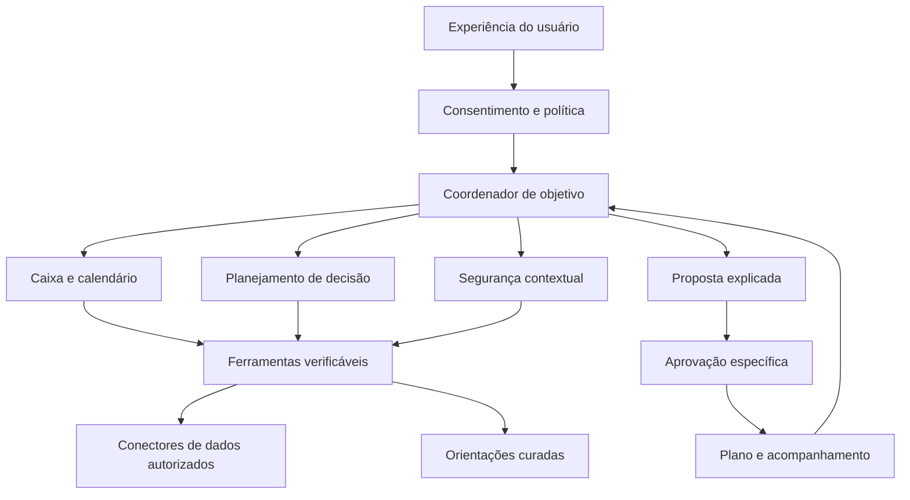
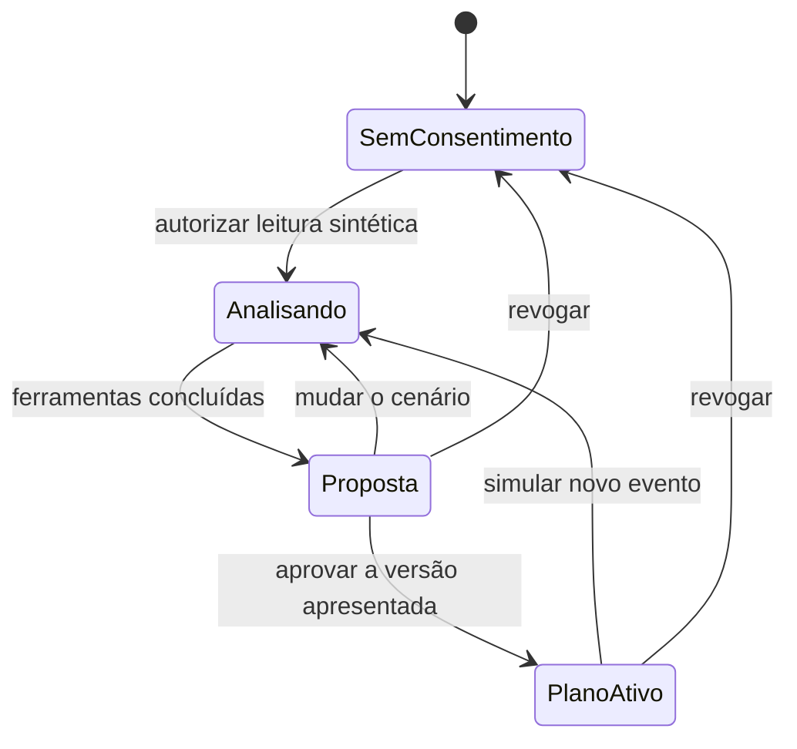

# Arquitetura e comportamento do agente

## Arquitetura alvo



O diagrama representa o desenho do produto, não três LLMs implantados. No protótipo, os papéis especializados são funções de domínio sob um coordenador. Isso permite testar a jornada sem criar uma arquitetura distribuída prematuramente.

## Responsabilidades

| Papel | Conhece | Decide ou produz | Ferramenta inicial |
| --- | --- | --- | --- |
| Coordenador | Objetivo, permissões e estado da jornada | Seleção limitada de ferramentas; síntese de ações | `build_report` e planejador opcional |
| Caixa | Saldo e eventos futuros | Projeção, menor saldo e distância da margem | `cashflow` |
| Planejamento | Preço, parcelas e compromissos | Impactos comparáveis e meta | `purchase`, `apply_saving` |
| Segurança | Sinais explicitamente fornecidos | Alerta ilustrativo e motivos | `safety` |
| Conhecimento | Conteúdo curado com origem | Orientação contextual | `guidance` |
| Política | Consentimento, snapshot e ações permitidas | Permite ou rejeita execução demonstrativa | `DemoSession.approve` |

## Fluxo implementado



O rastreamento mostra nome de ferramenta, papel e resultado da execução. As explicações apresentam os números calculados, hipóteses e itens excluídos de cada decisão. A trilha visível registra até 200 eventos com sequência e horário UTC: início da sessão, consentimento, consultas, aprovação, mudança de cenário, despesa simulada e revogação. Esses registros são observáveis; não divulgam raciocínio interno de modelos nem constituem auditoria de produção.

## IBM: papéis diferentes

**IBM Bob:** ferramenta de desenvolvimento prevista para construir, revisar e testar a solução. Não é o agente financeiro que atende o usuário. O material fornecido exige seu uso central e evidências no repositório. Esta preparação não comprova que o Bob foi utilizado; a equipe deve realizar e documentar esse trabalho.

**IBM watsonx.ai + Granite:** o adaptador opcional autentica no IAM e solicita a seleção das ferramentas permitidas. Os valores financeiros vêm do código. O ID do modelo é configurado com base na disponibilidade real da conta; não presumimos acesso a uma versão.

**IBM watsonx Orchestrate:** alternativa recomendada para a orquestração alvo. A equipe pode importar ferramentas e implementar os papéis no ambiente provisionado. Não há configuração Orchestrate implantada neste repositório.

O guia do lab trata Bob como obrigatório e as outras tecnologias como opcionais/recomendadas; o documento de desafios também orienta o uso de watsonx para a POC. Para atender às duas orientações, o plano inclui validar watsonx/Granite e confirmar com o mentor a expectativa da trilha.

## Contrato do planejador

Entrada: objetivo representado pelo cenário sintético, datas, compromissos e presença de compra ou intenção de PIX. Saída esperada:

```json
{"tools": ["cashflow", "guidance"]}
```

Há no máximo quatro ferramentas. Nomes desconhecidos e formatos inválidos são rejeitados pelo adaptador. A política exige caixa e orientação, além de compra/PIX quando aplicável. O modelo recebe uma cópia do cenário, não chama shell, não escolhe URLs e não executa operações financeiras. Configuração incompleta, falhas de rede e respostas inválidas ativam a contingência por regras, identificada na interface. As chamadas HTTPS usam verificação TLS explícita.

Os testes simulam o contrato desse componente; não validam uma integração IBM real. Não há planejamento aberto, negociação entre múltiplos modelos ou raciocínio financeiro generativo completo. A equipe ainda precisa avaliar escolhas de ferramenta, adequação da ação e recuperação de falhas em casos inéditos na conta do programa.

## Números, calendário e limites

- Valores monetários são inteiros em centavos, nunca ponto flutuante.
- Compromissos essenciais não são reduzidos pela ferramenta de orçamento.
- Reduções atingem somente saídas futuras marcadas como flexíveis.
- Recebimentos esperados não são garantidos. O protótipo usa datas fixas de cenário.
- Eventos do mesmo dia são agregados; não há modelagem de liquidez intradiária.
- Cada data do início ao fim do horizonte tem um fechamento, inclusive dias sem eventos. O saldo inicial é um dado separado; não cria um segundo ponto na mesma data.
- Eventos posteriores ao horizonte ficam no cenário, mas não entram no saldo, nos recebimentos considerados ou nas reduções propostas.
- A compra à vista é considerada hoje. No exemplo parcelado, só a primeira parcela entra no horizonte; as demais precisam de uma projeção longa antes de recomendar a contratação.
- A redução completa de lazer do exemplo é uma opção ilustrativa. Em produção, o usuário ajustará o limite e o sistema poderá apresentar um resultado parcial.

## Dados e integrações

No lab, todos os dados são sintéticos e não há formulário para extratos, dados pessoais ou chaves bancárias.

A arquitetura de produção poderia utilizar dados internos do BB e de outras instituições mediante consentimento e integração com participantes autorizados do Open Finance. Compartilhamento de dados não significa autorização para pagamento e não oferece, por si só, acesso garantido em tempo real a uma intenção de PIX.

Um alerta pré-pagamento depende de um ponto de integração específico na jornada transacional do banco. O protótipo recebe uma intenção fictícia fornecida pelo cenário; não intercepta o app BB nem monitora outros aplicativos.

## Persistência e autorização

Cada navegador recebe uma sessão demonstrativa independente. Um hash do snapshot identifica o contexto apresentado. A execução compara esse identificador com o relatório atual, verifica o consentimento e aplica somente o efeito permitido no servidor. Uma repetição da mesma aprovação não duplica o efeito.

Revogar a leitura oculta a análise e limpa os planos, metas e aprovações da sessão. A trilha mantém o registro da revogação e das consultas anteriores até a sessão expirar, permitindo verificar o que aconteceu. Trocar de cenário também limpa planos e metas, preservando essa trilha temporária.

O servidor não grava os estados em disco. Sessões ficam em memória, expiram após 30 minutos sem uso e são limitadas a 100. Reiniciar o processo descarta todas. A sessão demonstrativa não substitui identidade bancária, consentimento jurídico ou auditoria de produção.

Em produção: identidade do cliente validada pelo banco, escopos e expiração de consentimento, revogação efetiva, autenticação reforçada para operações sensíveis, idempotência, confirmação de valores, autorização transacional separada, trilha de auditoria e tratamento de falhas dos conectores.

## Recuperação local de orientações

`data/knowledge.json` contém quatro trechos curados: uma paráfrase com fonte do Banco Central e três orientações próprias do protótipo. A base e seu índice são carregados uma vez, na inicialização. `elo/retrieval.py` normaliza palavras em português, expande conceitos e sinônimos revisados e ordena os documentos do tópico por similaridade TF-IDF. Sem correspondência suficiente, retorna a busca por tópico; se o tópico não existe, não inventa conteúdo substituto.

`guidance` monta a consulta com o título e os eventos do cenário, além do contexto de compra ou PIX. A resposta informa consulta, conceitos encontrados, modo de recuperação e limite da cobertura. As URLs exibidas são filtradas para HTTP(S), com host e sem credenciais. Textos recuperados são inseridos como texto na interface, sem interpretar HTML.

É uma recuperação semântica leve por conceitos curados, sem embeddings, modelo treinado ou geração de respostas. A base pequena e os testes de paráfrases não comprovam relevância em perguntas reais. As datas de revisão identificam os textos; não significam atualização automática da fonte na internet.

Condições bancárias atuais não são consultadas. FGTS, crédito e investimentos não entram como respostas jurídicas ou financeiras presumidas. Uma evolução exige conteúdo permitido, controle de validade e avaliação com um conjunto separado de perguntas.

## Modo público de demonstração

`ELO_PUBLIC_ORIGIN` define uma única origem HTTPS, sem caminho. O servidor valida `Host` e `Origin`, não libera cabeçalhos CORS para outros sites e marca o cookie como `Secure`, `HttpOnly` e `SameSite=Strict`. Cabeçalhos CSP, proteção contra enquadramento e outras restrições complementam a validação. O HTTPS termina no proxy da hospedagem; a porta interna não deve ser exposta diretamente.

O processo limita requisições a 120 por minuto por IP da conexão, mantém até 1.024 contadores, admite até 16 workers e usa timeout de conexão de 10 segundos. Cabeçalhos de IP fornecidos pelo visitante não são confiados. Atrás de um proxy, visitantes podem compartilhar o mesmo contador. Esses limites não são uma defesa medida contra DDoS.

O modo público recusa o planejador IBM e permanece determinístico, para impedir chamadas anônimas cobradas. O Dockerfile usa usuário sem privilégios. O pacote foi preparado; a execução real da imagem e a hospedagem ainda precisam ser comprovadas conforme [Deploy](DEPLOY.md).

## Escala proposta

Separar API, fila de eventos, workers, armazenamento e conectores em uma etapa posterior. Cache de ferramentas respeitará revogação e validade dos dados. Alertas serão deduplicados e priorizados por relevância para evitar fadiga. Nenhuma capacidade de escala foi medida na base local atual.
